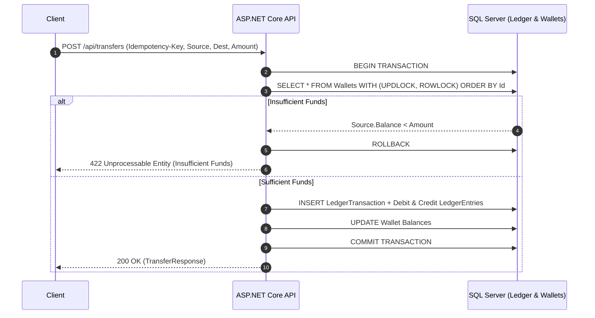

# Enterprise FinTech Wallet & Double-Entry Ledger API

[](https://github.com/dvmisani/fintech-wallet-ledger-dvmisani/actions/workflows/azure-deploy.yml)

A financial wallet and double-entry accounting ledger API built with **C# / .NET 10** and **Microsoft SQL Server**, engineered to enforce zero-sum ledger integrity, idempotent retries, and race-condition safety under concurrent load.

---

## Live Cloud Demo (Azure)

* **Interactive Swagger UI:** `https://fintech-wallet-ledger-dvmisani.azurewebsites.net/swagger`
* **Health Check:** `https://fintech-wallet-ledger-dvmisani.azurewebsites.net/health`

---

## Engineering Architecture & Trade-Offs

* **Double-Entry Accounting Model:** Every transfer generates paired `Debit` and `Credit` `LedgerEntry` rows linked to a single `LedgerTransaction` inside an atomic database transaction. Initial wallet funding debits a dedicated system treasury account so total debits always equal total credits across the entire ledger.
* **Pessimistic Row-Level Locking (`UPDLOCK`, `ROWLOCK`):** Under high contention on the same wallet, optimistic concurrency causes high retry failure rates. Locking target wallet rows with `WITH (UPDLOCK, ROWLOCK)` serializes conflicting balance mutations safely at the database row level.
* **Deterministic Lock Ordering:** Wallet IDs are sorted (`ORDER BY Id`) before acquiring row locks, preventing circular deadlocks when two wallets transfer funds to each other simultaneously.
* **Idempotency Guarantees:** Client-supplied `Idempotency-Key` headers backed by a unique database index (`IX_LedgerTransactions_IdempotencyKey`) prevent duplicate postings during network timeouts or retries.



---

## Automated Concurrency Verification (`xUnit` + `Testcontainers.MsSql`)

The integration test suite provisions an ephemeral SQL Server 2022 Docker container and verifies:
1. **Parallel Overdraft Prevention:** 20 simultaneous `R100` withdrawals against a `R1,000` wallet result in exactly 10 `200 OK` responses, 10 `422 Unprocessable Entity` rejections, a `R0.00` final balance, and global `SUM(Debits) == SUM(Credits)`.
2. **Concurrent Idempotency Safety:** 10 simultaneous retries with the same `Idempotency-Key` commit exactly once and return the identical `TransactionId`.
3. **Deadlock-Free Bidirectional Transfers:** 20 simultaneous `A -> B` and `B -> A` transfers complete with zero SQL deadlocks.

---

## Run Locally with Docker Compose

```bash
docker compose up --build
```
Open `http://localhost:8080/swagger` once the containers start.
